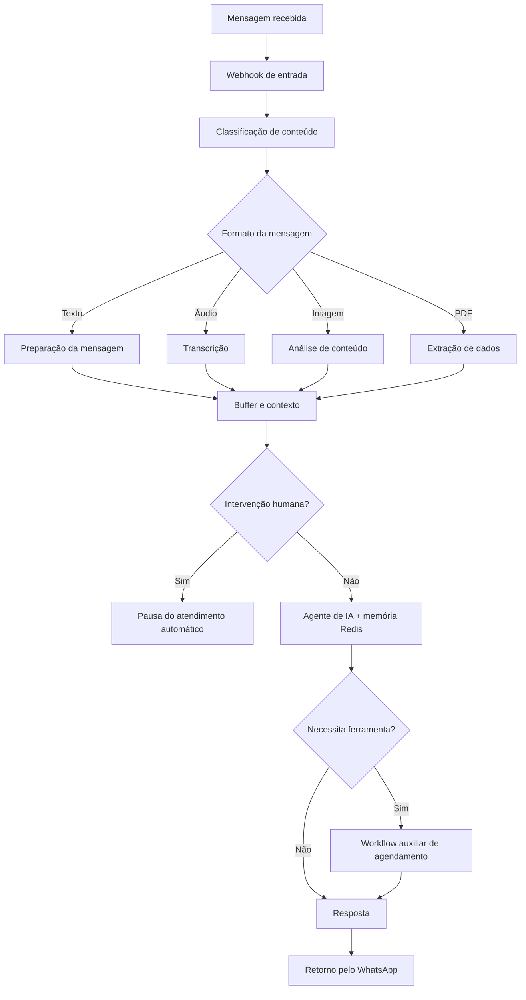

# Assistente de atendimento com IA — estudo de caso (n8n)

> **Portfólio técnico | Automação, agentes de IA e integração de sistemas**
>
> Esta documentação apresenta uma **visão anonimizada** de uma arquitetura desenvolvida no n8n. O workflow operacional original, dados de atendimento e integrações privadas **não estão disponíveis neste repositório**.

## Visão geral

Projeto de automação para organizar mensagens recebidas pelo WhatsApp, interpretar solicitações com um agente de IA e conectar o atendimento a rotinas auxiliares de agendamento. A arquitetura prevê classificação de conteúdo, tratamento de múltiplos formatos, memória conversacional e possibilidade de intervenção humana.

**Objetivo técnico:** estudar e aplicar orquestração de workflows, integração via API/webhook, agentes de IA e gerenciamento de contexto em um fluxo de atendimento.

## Tecnologias identificadas na implementação

| Tecnologia | Aplicação no fluxo |
| --- | --- |
| **n8n** | Orquestração do workflow principal e chamada a workflows auxiliares |
| **WAHA / WhatsApp** | Integração de mensagens de entrada e saída |
| **Google Gemini** | Modelo conectado ao agente e recursos de tratamento de mídia |
| **Redis** | Memória do contexto conversacional |
| **n8n Data Tables** | Buffer de mensagens e estados operacionais |
| **JavaScript (Code nodes)** | Tratamento e agrupamento de dados entre etapas |
| **HTTP / Webhooks** | Recebimento de eventos e comunicação com serviços |

## Arquitetura simplificada

*Diagrama conceitual: representa componentes identificados no export e não documenta, linha a linha, todas as ramificações ou o comportamento real de execução.*

## Funcionalidades representadas

- **Recepção por webhook** e tratamento de mensagens de texto, áudio, imagem e PDF.
- **Agente de IA** conectado a um modelo de linguagem e a uma memória de conversação.
- **Buffer** para agrupar mensagens próximas antes da resposta.
- **Integração modular** com workflows de consulta de agendamento, consulta de horários, criação e cancelamento de agendamento.
- **Lógica de intervenção humana** para permitir a suspensão do atendimento automatizado quando necessário.

> Os workflows auxiliares são **dependências separadas**. Seus detalhes completos não estão demonstrados pelo export do fluxo principal.

## Decisões de engenharia e aprendizados

1. **Separação de responsabilidades:** agente principal para entendimento e encaminhamento; workflows auxiliares para operações específicas.
2. **Contexto antes da resposta:** mensagens próximas são reunidas para reduzir respostas fragmentadas.
3. **Tratamento multimodal:** diferentes mídias convergem para informações que o agente pode processar.
4. **Intervenção humana:** a arquitetura contempla casos em que o atendimento automático deve parar.
5. **Privacidade por design na documentação:** o portfólio descreve decisões técnicas sem expor dados pessoais ou configurações reais.

## Limites deste repositório

Este é um **estudo de caso documental**, não uma aplicação de demonstração configurada para execução imediata. Não estão incluídos o workflow privado em JSON, prompts operacionais, credenciais, endpoints, IDs internos, amostras reais de mensagens nem dados de pessoas atendidas. A presença de componentes no export não equivale, por si só, à comprovação de todos os cenários em produção.

## Evolução prevista

- Criar um fluxo didático reproduzível usando mensagens **100% fictícias** e credenciais próprias de ambiente de teste.
- Adicionar testes de entrada por formato e de falhas de integração.
- Documentar validação de operações, observabilidade e tratamento de exceções.
- Exercitar boas práticas de segurança, privacidade e controle de acesso.

## Documentação complementar

- [Cenários de teste sugeridos](docs/cenarios-de-teste.md)
- [Política de privacidade deste portfólio](docs/privacidade.md)

---

**Autoria do portfólio:** [Luis Adolfo Herrera Vargas](https://github.com/adolfolhv2-79) · Estudante de Engenharia de Software · Em busca de estágio em tecnologia.
